# Class Activity 1 — System Calls in Practice

- **Student Name:** [THON LEANGHOR]
- **Student ID:** e20230197
- **Date:** [09 / 11  / 2026]
- **Environment:** macOS (Intel) + Ubuntu 26.04 LTS VM via Multipass, GCC 15.2, strace 6.19

---

## Warm-Up: Hello System Call

Screenshot of running `hello_syscall.c` on Linux:

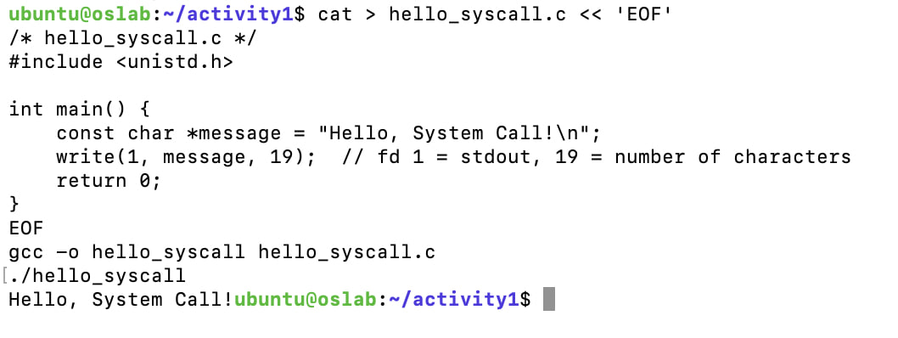

> Note: The string `"Hello, System Call!\n"` is 20 bytes, but the code writes only 19 bytes (`write(1, message, 19)`), so the newline is not printed and the shell prompt appears on the same line. This shows that `write()` writes exactly the number of bytes we ask for — nothing more.

Screenshot of running `hello_winapi.c` on Windows (CMD/PowerShell/VS Code):

> [If you could not run this: "I use macOS, so I could not run the Windows API example."]

Screenshot of running `copyfilesyscall.c` on Linux:

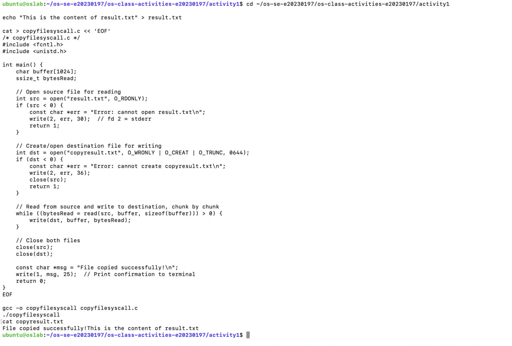

---

## Task 1: File Creator & Reader

### Part A — File Creator

**Describe your implementation:** Version A uses `fopen()`, `fprintf()`, `fclose()` and `printf()` from the C standard library. In Version B I replaced them with POSIX system calls: `open()` with `O_WRONLY | O_CREAT | O_TRUNC` and mode `0644` to create the file, `write()` to write the text into the file, `close()` to close it, and `write(1, ...)` to print the confirmation to the terminal. I used `strlen()` to get the exact number of bytes. Both versions produce the same terminal output and the same content in `output.txt`.

**Version A — Library Functions (`file_creator_lib.c`):**

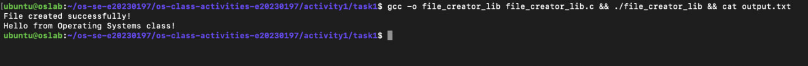

**Version B — POSIX System Calls (`file_creator_sys.c`):**

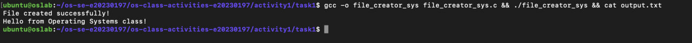

**Questions:**

1. **What flags did you pass to `open()`? What does each flag mean?**

   > `O_WRONLY | O_CREAT | O_TRUNC`
   > - `O_WRONLY` — open the file for writing only.
   > - `O_CREAT` — create the file if it does not exist.
   > - `O_TRUNC` — if the file already exists, erase its old content (length becomes 0).

2. **What is `0644`? What does each digit represent?**

   > `0644` is the file permission in octal.
   > - `0` — the leading zero means the number is octal.
   > - `6` — owner: read (4) + write (2) = `rw-`
   > - `4` — group: read only = `r--`
   > - `4` — others: read only = `r--`
   >
   > So the file is `-rw-r--r--`.

3. **What does `fopen("output.txt", "w")` do internally that you had to do manually?**

   > `fopen()` with mode `"w"` internally calls `open("output.txt", O_WRONLY | O_CREAT | O_TRUNC, 0666)` (the umask then makes it 0644). It also allocates a `FILE` structure and an I/O buffer with `malloc()`. With system calls I had to choose the flags and permissions myself, and there is no buffer — every `write()` goes directly to the kernel.

### Part B — File Reader & Display

**Describe your implementation:** Version B opens `output.txt` with `open(..., O_RDONLY)`, then reads it in a loop with `read(fd, buffer, sizeof(buffer))`. Each chunk is printed with `write(1, buffer, bytesRead)`. The loop stops when `read()` returns 0 (end of file). Finally the file is closed with `close()`.

**Version A — Library Functions (`file_reader_lib.c`):**

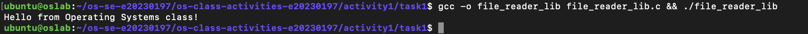

**Version B — POSIX System Calls (`file_reader_sys.c`):**

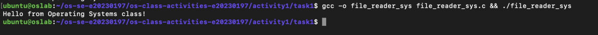

**Questions:**

1. **What does `read()` return? How is this different from `fgets()`?**

   > `read()` returns the **number of bytes** actually read: a positive number, `0` at end of file, or `-1` on error. It reads raw bytes and does not care about lines or add a `'\0'`.
   > `fgets()` returns a **pointer to a string** (or `NULL` at end of file/error). It reads one line at a time (stops at `\n`), adds a `'\0'` at the end, and uses an internal buffer.

2. **Why do you need a loop when using `read()`? When does it stop?**

   > `read()` reads at most `count` bytes (the buffer size, 256 here) per call, so a file bigger than the buffer needs several calls. The loop keeps reading until `read()` returns `0` (end of file) — or `-1` on error.

---

## Task 2: Directory Listing & File Info

**Describe your implementation:** I kept `opendir()`, `readdir()`, `stat()` and `closedir()`, but replaced every `printf()` with `snprintf()` + `write()`. `snprintf()` formats the filename and size into a char buffer, `strlen()` gives the length, and `write(1, buffer, len)` prints it. Both versions show the same file listing.

### Version A — Library Functions (`dir_list_lib.c`)

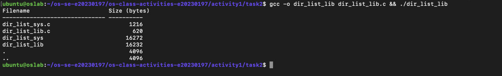

### Version B — System Calls (`dir_list_sys.c`)

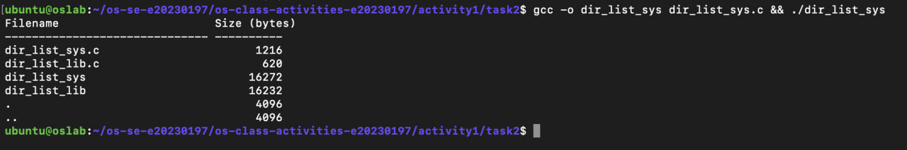

### Questions

1. **What struct does `readdir()` return? What fields does it contain?**

   > It returns a pointer to `struct dirent`. Main fields:
   > - `d_ino` — inode number
   > - `d_off` — offset to the next entry
   > - `d_reclen` — length of this record
   > - `d_type` — file type (regular file, directory, link, ...)
   > - `d_name` — file name

2. **What information does `stat()` provide beyond file size?**

   > `struct stat` also contains: `st_mode` (file type and permissions), `st_ino` (inode), `st_nlink` (number of hard links), `st_uid` / `st_gid` (owner user and group), `st_atime` / `st_mtime` / `st_ctime` (last access, modification, status change times), `st_blksize` and `st_blocks` (block size and blocks used), and `st_dev` (device).

3. **Why can't you `write()` a number directly — why do you need `snprintf()` first?**

   > `write()` only copies raw bytes. If I pass an integer like `1216`, it would write its binary representation (4 or 8 bytes of memory), which shows as garbage on the terminal. The terminal needs text characters (`'1' '2' '1' '6'`). `snprintf()` converts the number into a string of ASCII characters, and then `write()` can print that string.

---

## Optional Bonus: Windows API (`file_creator_win.c`)

Screenshot of running on Windows:

> [Remove this section if you did not do the bonus.]

### Bonus Questions

1. **Why does Windows use `HANDLE` instead of integer file descriptors?**

   > [Your answer]

2. **What is the Windows equivalent of POSIX `fork()`? Why is it different?**

   > [Your answer]

3. **Can you use POSIX calls on Windows?**

   > [Your answer]

---

## Task 3: strace Analysis

**Describe what you observed:** Most system calls in both versions are not from my code at all. They are program startup done by the dynamic loader (`execve`, `mmap`, `mprotect`, `openat` for `ld.so.cache` and `libc.so.6`). The library version made **38** system calls and the system call version made **34**, so the library version made 4 more (2 extra `fstat`, 2 extra `brk`). What surprised me is that `fprintf()` did not write immediately. Its data was buffered and written with one `write()` when the file was closed.

### strace Output — Library Version (File Creator)

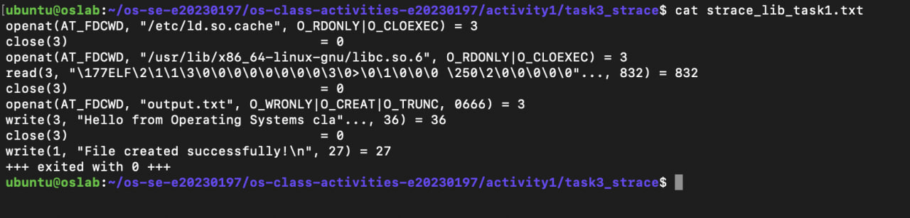

### strace Output — System Call Version (File Creator)

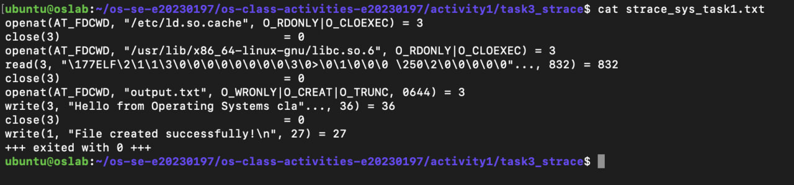

### strace Output — Library Version (File Reader)

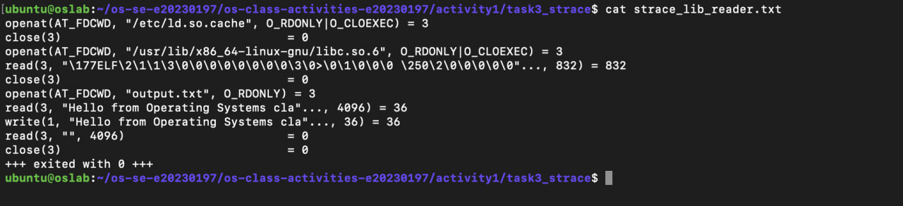

### strace Output — System Call Version (File Reader)

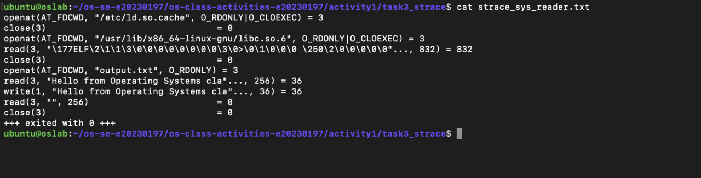

### strace -c Summary Comparison

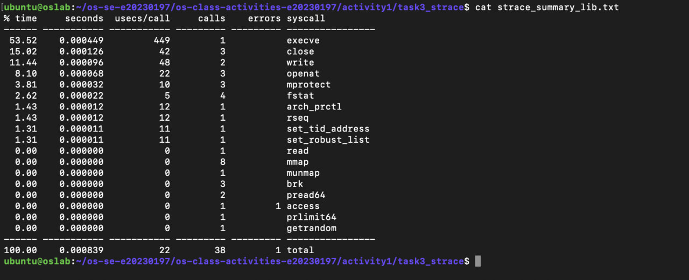
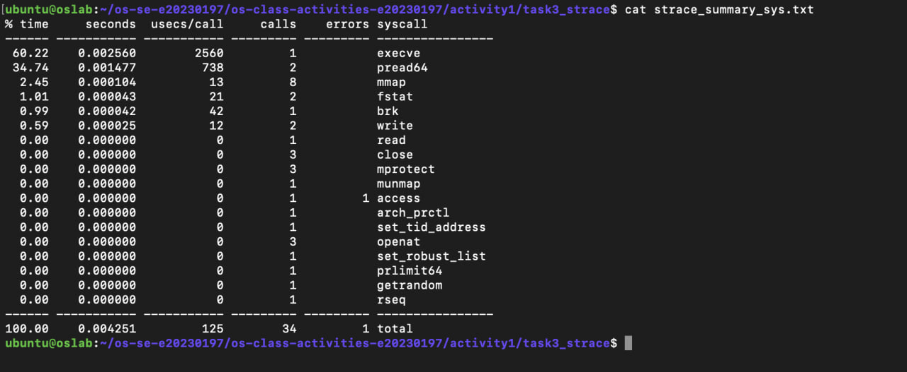

| syscall | Library version | Syscall version |
|---|---|---|
| fstat | 4 | 2 |
| brk | 3 | 1 |
| write | 2 | 2 |
| openat | 3 | 3 |
| close | 3 | 3 |
| mmap | 8 | 8 |
| **total** | **38** | **34** |

### Questions

1. **How many system calls does the library version make compared to the system call version?**

   > The library version makes **38** system calls and the system call version makes **34** (from `strace -c`). The difference is 4 calls: 2 extra `fstat` and 2 extra `brk`.

2. **What extra system calls appear in the library version? What do they do?**

   > - `brk` (3 vs 1) — grows the heap. `fopen()` calls `malloc()` to allocate the `FILE` structure and its I/O buffer.
   > - `fstat` (4 vs 2) — gets file information. libc uses it to choose the buffer size for `output.txt` and for stdout.
   > - Both versions also use `mmap`, `mprotect` and `openat("libc.so.6")` to load the shared C library at startup.

3. **How many `write()` calls does `fprintf()` actually produce?**

   > Only **1**. The library version has 2 `write()` calls in total: one for `fprintf()` to the file and one for `printf()` to the terminal. `fprintf()` stores the text in a buffer, and the buffer is flushed with a single `write()` when `fclose()` is called. This matches what I expected because stdio buffers output to reduce the number of system calls.

4. **In your own words, what is the real difference between a library function and a system call?**

   > A system call (`open`, `read`, `write`, `close`) is a direct request to the kernel. The CPU switches from user mode to kernel mode to do the work. A library function (`fopen`, `fprintf`, `printf`) runs in user space as a wrapper around system calls. It adds convenience features such as formatting, buffering and memory management, but it still has to make system calls in the end to talk to the OS. strace shows this clearly: `fprintf()` appears in the trace as a `write()` system call.

---

## Task 4: Exploring OS Structure

### System Information

> 📸 Screenshot of `uname -a`, `/proc/cpuinfo`, `/proc/meminfo`, `/proc/version`, `/proc/uptime`:

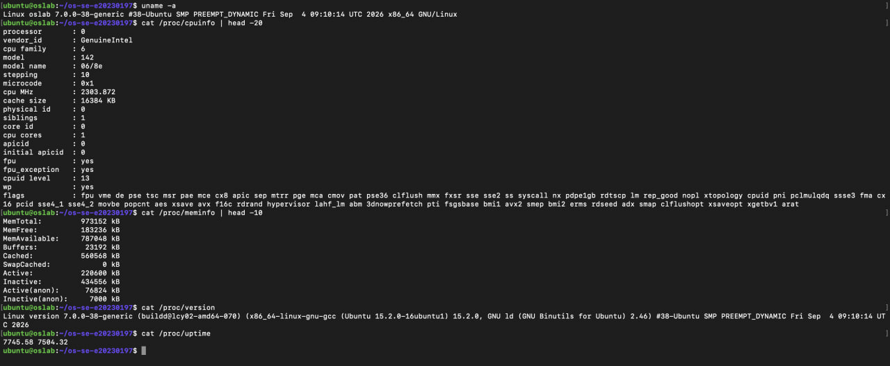

### Process Information

> 📸 Screenshot of `/proc/self/status`, `/proc/self/maps`, `ps aux`:

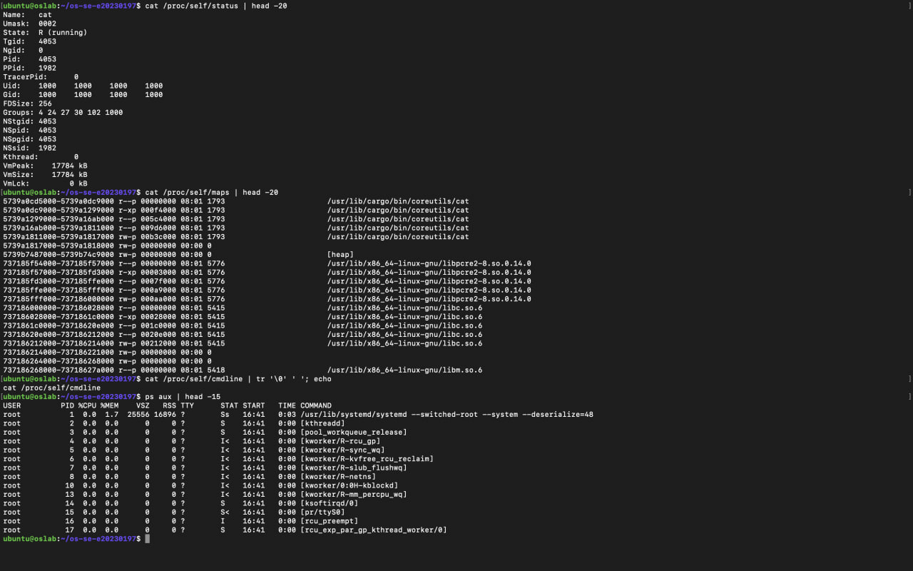

### Kernel Modules

> 📸 Screenshot of `lsmod` and `modinfo`:

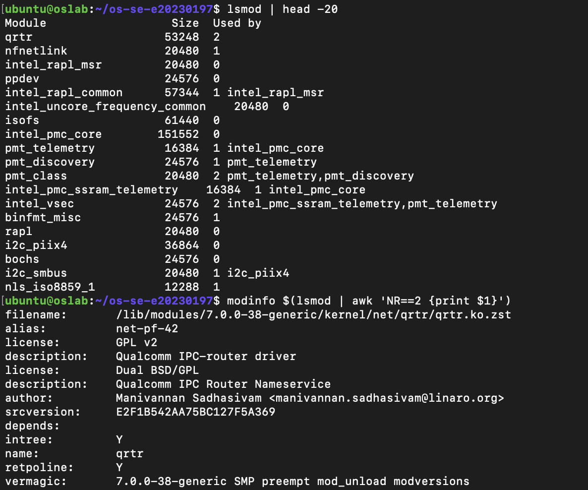

### OS Layers Diagram

> 📸 Your diagram of the OS layers, labeled with real data from your system:

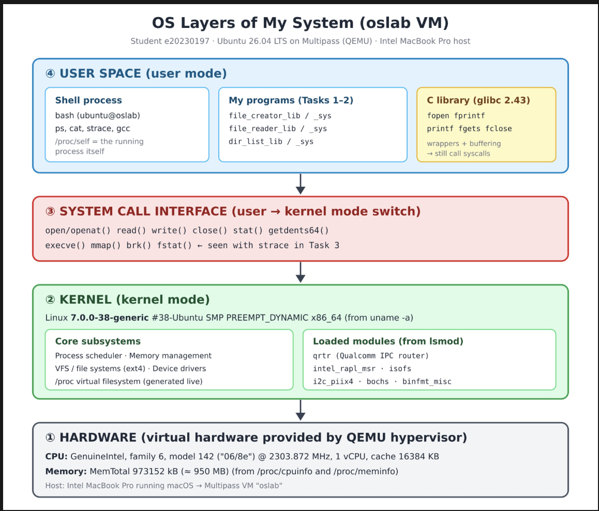

### Questions

1. **What is `/proc`? Is it a real filesystem on disk?**

   > `/proc` is a **virtual filesystem** (type `proc`). It is **not stored on disk**. The files take no disk space, and the kernel generates their content on the fly from its internal data structures whenever a program reads them. For example, `cat /proc/meminfo` asks the kernel for the current memory statistics at that moment. That is why `/proc/uptime` shows a different value every time I read it.

2. **Monolithic kernel vs. microkernel — which type does Linux use?**

   > In a **monolithic kernel**, all core OS services (scheduler, memory management, file systems, device drivers, networking) run together in one large program in kernel space. In a **microkernel**, only the minimum (IPC, basic scheduling, memory) runs in kernel space, and the other services run as separate processes in user space.
   > Linux is a **monolithic kernel, but modular**. The `lsmod` output shows modules such as `qrtr`, `intel_rapl_msr`, `isofs`, `i2c_piix4` and `bochs` that were loaded at runtime. But these modules are loaded **into kernel space** and run with full kernel privileges, so Linux is still monolithic, not a microkernel. Modules only make it flexible.

3. **What memory regions do you see in `/proc/self/maps`?**

   > Each line of `/proc/self/maps` is one memory region of the running process (`cat`, PID 4053). It shows the address range, permissions (`r` read, `w` write, `x` execute, `p` private), offset, device, inode and the mapped file. In my output I can see:
   > - **The program itself**: `/usr/lib/cargo/bin/coreutils/cat` (on Ubuntu 26.04 `cat` comes from the Rust coreutils). It has 5 regions: read-only headers/constants (`r--p`), the executable **code/text** segment (`r-xp`), read-only data (`r--p`) and writable **data/BSS** (`rw-p`).
   > - **Anonymous `rw-p` regions** (no file name): extra writable memory for global variables (BSS).
   > - **`[heap]`**: dynamic memory allocated with `malloc()` (grown by the `brk` system call).
   > - **Shared libraries**: `libpcre2-8.so.0.14.0`, `libc.so.6` (the C library) and `libm.so.6` (the math library). Each one also has separate code (`r-xp`), read-only and data (`rw-p`) regions.
   > - The regions after the first 20 lines also include the dynamic loader `ld-linux-x86-64.so.2`, the **`[stack]`** (local variables and function calls), and **`[vvar]`/`[vdso]`** (pages the kernel maps into every process so calls like getting the time are fast).
   >
   > This shows that each process has its own virtual address space, with the kernel deciding where code, data, heap, libraries and stack are placed.

4. **Break down the kernel version string from `uname -a`.**

   > `Linux oslab 7.0.0-38-generic #38-Ubuntu SMP PREEMPT_DYNAMIC Fri Sep 4 09:10:14 UTC 2026 x86_64 GNU/Linux`
   > - `Linux` — kernel name
   > - `oslab` — hostname of my machine (the VM)
   > - `7.0.0` — kernel version (major 7, minor 0, patch 0)
   > - `-38` — Ubuntu's build/ABI number for this kernel
   > - `generic` — kernel flavour (general-purpose desktop/server build)
   > - `#38-Ubuntu` — the build number, made by Ubuntu
   > - `SMP` — supports Symmetric Multi-Processing (multiple CPUs)
   > - `PREEMPT_DYNAMIC` — the preemption model can be chosen at boot time
   > - `Fri Sep 4 09:10:14 UTC 2026` — date and time the kernel was compiled
   > - `x86_64` — CPU architecture (64-bit Intel/AMD)
   > - `GNU/Linux` — operating system (GNU tools + Linux kernel)

5. **How does `/proc` show that the OS is an intermediary between programs and hardware?**

   > My programs never talk to the CPU or RAM directly. When I run `cat /proc/cpuinfo` or `cat /proc/meminfo`, `cat` only makes normal `open()`/`read()` system calls, and the **kernel** answers with information about the hardware it manages. The kernel controls the hardware and decides what to show to user programs. A good example in my system: `/proc/cpuinfo` shows `model name : 06/8e` and the `hypervisor` flag, because my Ubuntu runs inside a VM. The kernel only sees the virtual CPU that QEMU gives it, and programs only see what the kernel reports. So `/proc` is a window that the OS opens between user programs and the (virtual) hardware.

---

## Reflection

> [Write your reflection here — what you learned and what surprised you most about library functions vs system calls.]
