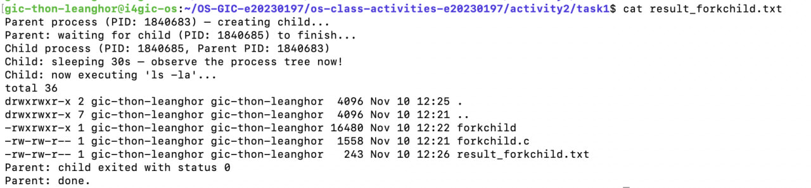
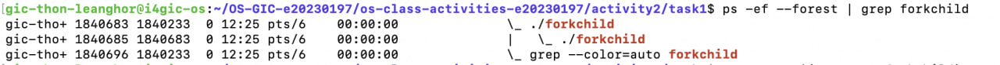
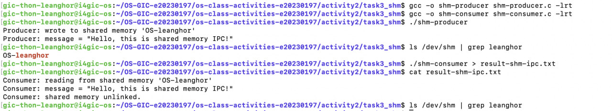
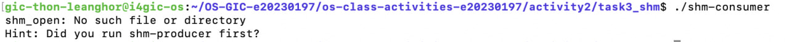
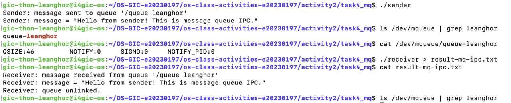
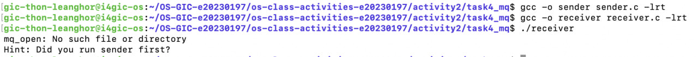

# Class Activity 2 — Processes & Inter-Process Communication

- **Student Name:** THON LEANGHOR
- **Student ID:** e20230197
- **Date:** [10 / 11 / 2026]
- **Environment:** School Linux server `i4gic-os` (Ubuntu 26.04.1 LTS, kernel 7.0.0-38-generic, x86_64) via SSH + Cloudflare Tunnel

---

## Task 1: Process Creation on Linux (fork + exec)

### Compilation & Execution

Screenshot of compiling and running `forkchild.c`:



> Note: I ran the program in the background (`./forkchild > result_forkchild.txt 2>&1 &`) so I could check the process tree from the same terminal while the child was sleeping, then used `wait` and `cat` to see the result.
>
> I also added `fflush(stdout)` before `fork()` and before `execlp()`. Because the output is redirected to a file, `printf()` is fully buffered. Without the first `fflush`, the unflushed buffer is copied into the child by `fork()`, so the "Parent process..." line would appear twice. Without the second one, the child's messages would be lost, because `execlp()` replaces the whole process image, including the unflushed stdio buffer.

### Process Tree

Screenshot of the parent-child process tree (using `ps -ef --forest`):



### Output

```
Parent process (PID: 1840683) — creating child...
Parent: waiting for child (PID: 1840685) to finish...
Child process (PID: 1840685, Parent PID: 1840683)
Child: sleeping 30s — observe the process tree now!
Child: now executing 'ls -la'...
total 36
drwxrwxr-x 2 gic-thon-leanghor gic-thon-leanghor  4096 Nov 10 12:25 .
drwxrwxr-x 7 gic-thon-leanghor gic-thon-leanghor  4096 Nov 10 12:21 ..
-rwxrwxr-x 1 gic-thon-leanghor gic-thon-leanghor 16480 Nov 10 12:22 forkchild
-rw-rw-r-- 1 gic-thon-leanghor gic-thon-leanghor  1558 Nov 10 12:21 forkchild.c
-rw-rw-r-- 1 gic-thon-leanghor gic-thon-leanghor   243 Nov 10 12:26 result_forkchild.txt
Parent: child exited with status 0
Parent: done.
```

### Questions

1. **What does `fork()` return to the parent? What does it return to the child?**

   > `fork()` returns **the child's PID** (a positive number) to the **parent**, and **0** to the **child**. If it fails, it returns **-1** to the parent and no child is created. In my run, the parent received `1840685` (the child's PID), and the child got `0`, which is why it entered the `else if (pid == 0)` branch.

2. **What happens if you remove the `waitpid()` call? Why might the output look different?**

   > Without `waitpid()`, the parent does not wait. It prints "Parent: done." and exits immediately, while the child is still sleeping. The output order changes: the parent's final messages appear **before** the child's `ls -la` output, and the shell prompt may come back before the child finishes. Because the parent has died, the child becomes an **orphan** and is adopted by `init`/`systemd` (its PPID changes to 1 or to a subreaper). Also, the parent can no longer read the child's exit status. If the parent was still alive but never called `wait`, the finished child would stay as a **zombie** (`<defunct>`) in the process table.

3. **What does `execlp()` do? Why don't we see "execlp failed" when it succeeds?**

   > `execlp()` **replaces the current process image** with a new program. It searches `PATH` for `ls`, loads it into memory and starts it with the arguments `ls -la`. The PID stays the same (`1840685`), but the code, data, heap and stack are all replaced by `ls`. Because the old program is gone, `execlp()` **never returns when it succeeds**, so the lines after it (`perror("execlp")` and `exit(EXIT_FAILURE)`) are never executed. They only run if `execlp()` fails, for example if the program is not found.

4. **Draw the process tree for your program (parent → child). Include PIDs from your output.**

   > ```
   > bash (PID 1840233)                 ← my SSH shell
   >   └── ./forkchild (PID 1840683)    ← parent, PPID 1840233
   >         └── ./forkchild (PID 1840685)  ← child created by fork(), PPID 1840683
   >               └── (after 30s, exec replaces it with "ls -la", same PID 1840685)
   > ```

5. **Which command did you use to view the process tree (`ps --forest`, `pstree`, or `htop`)? What information does each column show?**

   > I used `ps -ef --forest | grep forkchild`:
   > ```
   > gic-tho+ 1840683 1840233  0 12:25 pts/6  00:00:00  \_ ./forkchild
   > gic-tho+ 1840685 1840683  0 12:25 pts/6  00:00:00  |   \_ ./forkchild
   > ```
   > - **UID** (`gic-tho+`): the user who owns the process (name truncated)
   > - **PID**: the process ID (`1840683` parent, `1840685` child)
   > - **PPID**: the parent's PID. The child's PPID `1840683` equals the parent's PID, and the parent's PPID `1840233` is my bash shell
   > - **C**: CPU usage (0 because both are just sleeping/waiting)
   > - **STIME**: start time (12:25)
   > - **TTY**: the terminal the process is attached to (`pts/6`, my SSH session)
   > - **TIME**: total CPU time used
   > - **CMD**: the command. The `\_` and indentation from `--forest` draw the tree, showing the child under the parent

---

## Task 2: Process Creation on Windows

> ⚠️ **Not completed.** I use a Mac and did not have access to a Windows computer, so I could not run `winprocess.c` or take the Task Manager screenshots.
### Compilation & Execution

Screenshot of compiling and running `winprocess.c`:


### Task Manager Screenshots

Screenshot showing process tree in the **Processes** tab (mspaint nested under your program):


Screenshot showing PID and Parent PID in the **Details** tab:


### Questions

1. **What is the key difference between how Linux creates a process (`fork` + `exec`) and how Windows does it (`CreateProcess`)?**

   > Linux uses **two steps**: `fork()` first makes a copy of the parent (same code, a copy of its memory), then `exec()` replaces that copy with a new program. Between the two calls the child can set things up (redirect files, change directory, etc.). Windows uses **one step**: `CreateProcess()` creates a brand-new process and loads the specified program (`mspaint.exe`) directly. There is no copy of the parent. All settings (command line, environment, working directory, handle inheritance) are passed as parameters. Windows also returns **handles** (`pi.hProcess`, `pi.hThread`) as well as the PID.

2. **What does `WaitForSingleObject()` do? What is its Linux equivalent?**

   > `WaitForSingleObject(pi.hProcess, INFINITE)` **blocks the parent** until the object (here, the child process handle) becomes signaled, which happens when the child process exits. `INFINITE` means wait with no timeout. The Linux equivalent is `waitpid(pid, &status, 0)` (or `wait()`), which I used in Task 1. To get the exit code on Windows you call `GetExitCodeProcess()`, which is similar to `WEXITSTATUS(status)` on Linux.

3. **Why do we need to call `CloseHandle()` at the end? What happens if we don't?**

   > `CreateProcess()` gives the parent two kernel **handles** (process and main thread). Each handle is a reference to a kernel object. `CloseHandle()` releases these references so the kernel can free the objects. If we don't close them, we get a **handle leak**: the kernel keeps the process/thread objects in memory even after mspaint exits. In a short program, Windows cleans up when our program ends, but in a long-running program (for example a server that starts many child processes) the leaked handles would pile up and waste kernel resources.

4. **In Task Manager, what was the PID of your parent program and the PID of mspaint? Do they match your program's output?**

   > [Fill in from your screenshots: winprocess.exe PID = ____, mspaint.exe PID = ____, mspaint's Parent PID = ____. Explain that the Child PID printed by the program matches mspaint's PID in Task Manager, and mspaint's Parent PID matches winprocess.exe's PID.]

5. **Compare the Processes tab (tree view) and the Details tab (PID/PPID columns). Which view makes it easier to understand the parent-child relationship? Why?**

   > [Your answer — e.g. the Processes tab is easier to see at a glance because mspaint is visually nested under the parent, but the Details tab is more precise because it shows the exact PID and Parent PID numbers, which prove the relationship.]

---

## Task 3: Shared Memory IPC

### Compilation & Execution

Screenshot of compiling and running `shm-producer` and `shm-consumer`:



> I used the unique name `OS-leanghor`. `ls /dev/shm` shows that the shared memory object exists after the producer runs, and that it is gone after the consumer calls `shm_unlink()`.

### Output

```
Consumer: reading from shared memory 'OS-leanghor'
Consumer: message = "Hello, this is shared memory IPC!"
Consumer: shared memory unlinked.
```

### Questions

1. **What does `shm_open()` do? How is it different from `open()`?**

   > `shm_open()` creates or opens a **POSIX shared memory object** by name and returns a file descriptor for it. `open()` opens a regular file on disk. A shared memory object is not stored on disk. On Linux it lives in `/dev/shm`, which is a `tmpfs` filesystem in RAM. Its name is not a normal path (just `OS-leanghor`), and a new object has size 0, so we must call `ftruncate()` to give it a size. The descriptor is meant to be used with `mmap()`, not with `read()`/`write()` like a normal file.

2. **What does `mmap()` do? Why is shared memory faster than other IPC methods?**

   > `mmap()` maps the shared memory object into the process's **virtual address space** and returns a pointer (`ptr`) to it. After that, the process accesses the memory with normal pointer operations (`sprintf(ptr, ...)`), like an ordinary array. Because both processes map the **same physical memory pages**, data written by the producer is immediately visible to the consumer. Shared memory is the fastest IPC method because after setup **no system calls and no copying** are needed for each data transfer. With pipes or message queues, every message is copied from the sender into the kernel and then from the kernel into the receiver, which needs a system call each time.

3. **Why must the shared memory name match between producer and consumer?**

   > The name is how the kernel identifies the shared memory object, like a file name. The consumer finds the object the producer created by calling `shm_open()` with the **same name**. If the names were different (for example `OS-leanghor` and `OS-yourname`), the consumer would try to open a different object that does not exist and fail with `No such file or directory`. This is also why each student uses a unique name on the shared server: otherwise two students could read or overwrite each other's data.

4. **What does `shm_unlink()` do? What would happen if the consumer didn't call it?**

   > `shm_unlink()` **removes the name** of the shared memory object. Once no process has it mapped, the kernel frees the memory. My screenshot shows `OS-leanghor` disappearing from `/dev/shm` after the consumer runs. If the consumer did not call it, the object would **stay in `/dev/shm` and keep using RAM** even after both programs have exited. It persists until someone unlinks it or the system reboots. This is a resource leak, and the old data could also be read by the next program that opens the same name.

5. **If the consumer runs before the producer, what happens? Try it and describe the error.**

   > 
   >
   > The consumer fails immediately:
   > ```
   > shm_open: No such file or directory
   > Hint: Did you run shm-producer first?
   > ```
   > The consumer opens the object with `O_RDONLY` and no `O_CREAT`, so `shm_open()` only opens an existing object. Because the producer has not created `OS-leanghor` yet (or the previous consumer already unlinked it), it returns -1 with `errno = ENOENT`. `perror()` prints this as "No such file or directory", and the program exits.

---

## Task 4: Message Queue IPC

### Compilation & Execution

Screenshot of compiling and running `sender` and `receiver`:



> I used the unique queue name `/queue-leanghor`. After the sender runs, the queue appears in `/dev/mqueue`, and `cat /dev/mqueue/queue-leanghor` shows `QSIZE:46`: one message of 46 bytes (45 characters + `'\0'`) waiting in the queue. After the receiver runs, the queue is gone because of `mq_unlink()`.

### Output

```
Receiver: message received from queue '/queue-leanghor'
Receiver: message = "Hello from sender! This is message queue IPC."
Receiver: queue unlinked.
```

### Questions

1. **How is a message queue different from shared memory? When would you use one over the other?**

   > With **shared memory**, both processes access the same memory region directly. It is the fastest method, but there is no structure and no synchronization: the programmer must decide the data format and use semaphores/mutexes so that the reader does not read while the writer is writing. With a **message queue**, the kernel stores separate **messages** in order (FIFO, with optional priorities). Each `mq_send()`/`mq_receive()` copies the data through the kernel, so it is slower, but the kernel handles synchronization: `mq_receive()` blocks until a message arrives, and messages keep their boundaries.
   > - Use **shared memory** for large amounts of data or very frequent updates (video frames, big arrays, databases).
   > - Use a **message queue** for small, separate messages, commands or events between processes, when simplicity and built-in ordering/synchronization matter more than speed.

2. **Why does the queue name in `common.h` need to start with `/`?**

   > POSIX requires portable message queue names to have the form `/somename`: one leading slash followed by characters that are not slashes. On Linux, `mq_open()` returns `EINVAL` if the name does not follow this rule. The slash shows that it is a system-wide name, not a path relative to the current directory. Linux stores the queues in the special `mqueue` filesystem, so `/queue-leanghor` appears as `/dev/mqueue/queue-leanghor`, as I saw in my screenshot.

3. **What does `mq_unlink()` do? What happens if neither the sender nor receiver calls it?**

   > `mq_unlink()` **removes the queue's name** from the system. The queue is destroyed when all processes have closed it. `mq_close()` only closes this process's descriptor and does not delete the queue. If nobody calls `mq_unlink()`, the queue **stays in the kernel** (visible in `/dev/mqueue`) after both programs exit, together with any unread messages, until it is unlinked or the system reboots. It keeps using kernel memory and counts toward the user's queue limits, and old messages would be received by the next program that opens the same name.

4. **What happens if you run the receiver before the sender?**

   > 
   >
   > The receiver fails:
   > ```
   > mq_open: No such file or directory
   > Hint: Did you run sender first?
   > ```
   > The receiver calls `mq_open(QUEUE_NAME, O_RDONLY)` without `O_CREAT`, so it can only open an existing queue. The sender has not created `/queue-leanghor` yet, so `mq_open()` fails with `ENOENT`. (If the receiver opened the queue with `O_CREAT`, it would create an empty queue and then **block** in `mq_receive()` until the sender sends a message.)

5. **Can multiple senders send to the same queue? Can multiple receivers read from the same queue?**

   > **Yes to both.** Any number of processes can open the same queue name and call `mq_send()`. Their messages are put in the queue in order (by priority, then FIFO). Multiple receivers can also open the queue, but **each message is delivered to only one receiver**: whichever process calls `mq_receive()` first takes it out of the queue, and the others do not get a copy. So a message queue works like a shared work queue (load balancing), not like a broadcast. To send the same message to every receiver, you would need one queue per receiver or a different mechanism.

---

## Reflection

> [Write your reflection here in your own words — what you learned, the most interesting difference between Linux and Windows process creation, and which IPC method you prefer and why.]
