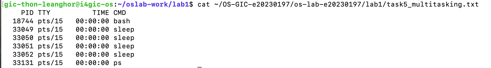
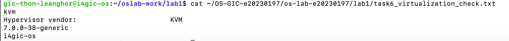

# OS Lab 1 - Linux & Git Basics

**Student Name:** THON LEANGHOR  
**Student ID:** e20230197

## Task 3 - Software Package Management (APT)

## Task 5 - Multitasking

## Task 6 - Virtualization Check
